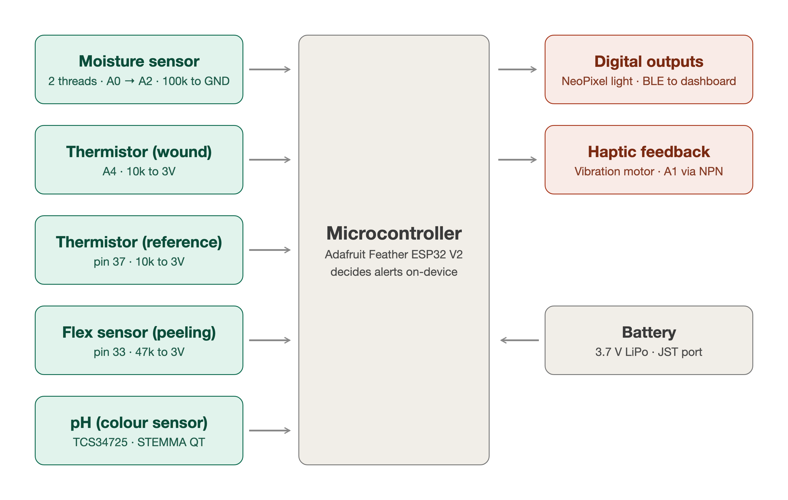
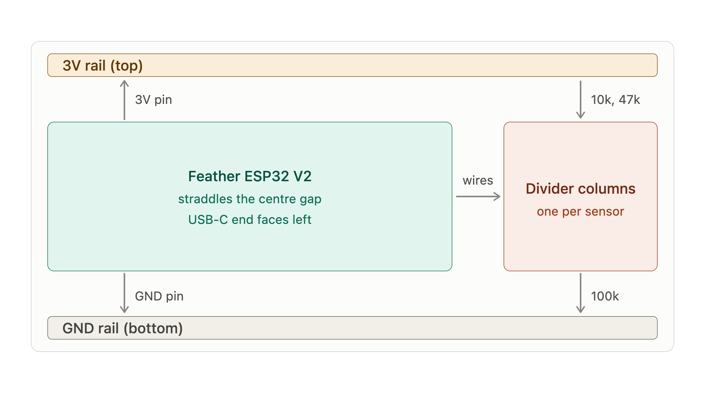
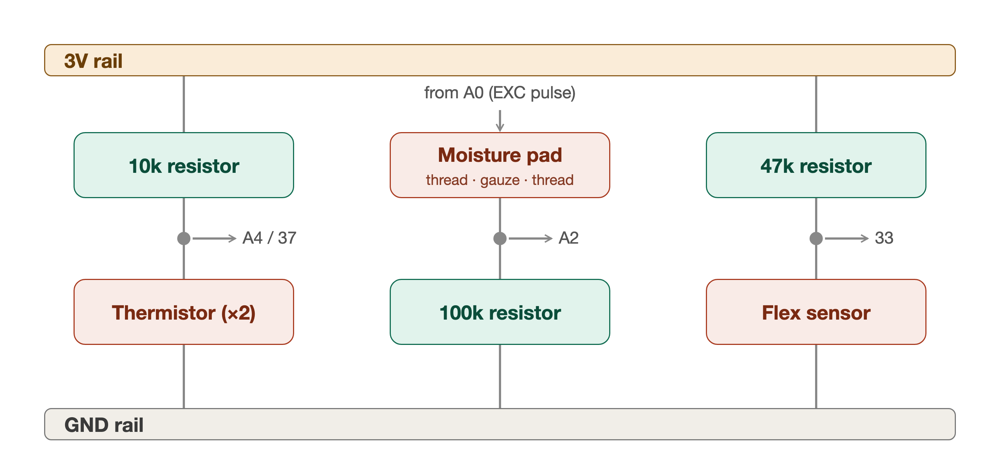
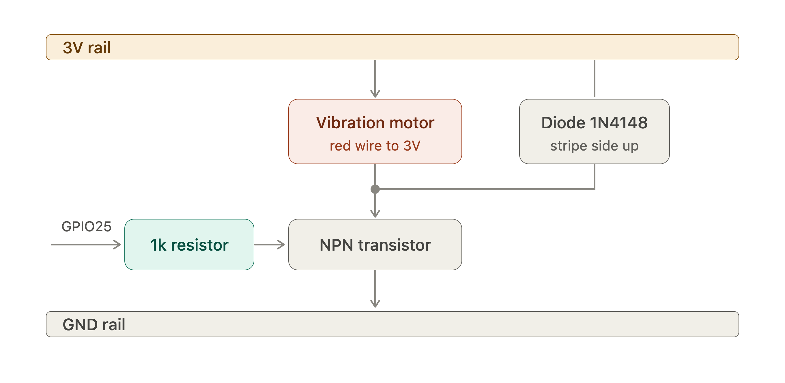

# DressCheck

Smart wound-dressing monitor for **natHacks 2026** (Edmonton · Standard Division · Healthcare & Accessibility).

A disposable sensing dressing plugs into a reusable pod. The pod watches moisture, wound temperature (against a reference thermistor), pH (by reading a pH strip's colour), and peeling (flex sensor). Decision logic and haptic/LED alerts run on the device so they still fire if the phone drops. A Web Bluetooth dashboard (Chrome) shows live readings and lets a clinician set thresholds: **https://ddc6406.github.io/SmartDress/**

**Prototype only.** Tested on a skin-phantom rig. No real wounds. The device never diagnoses — it compares readings to clinician-set criteria and surfaces messages like “your clinician’s criteria say it’s time to change your dressing” or “contact your clinic for review.”

---

## What’s in the box (prototype)

| Piece | Role |
| --- | --- |
| Sensing dressing | Moisture pad (two conductive threads on gauze), wound + reference thermistors, pH strip read by the colour sensor, flex sensor for peeling |
| DressCheck pod | Adafruit Feather ESP32 V2 + divider resistors, vibration motor, NeoPixel light, LiPo battery |
| Phone / laptop | Chrome Web Bluetooth clinician / patient UI |

Hardware detail and breadboard steps live in the team build guide. Sensor conversion assumptions are documented in [`docs/sensor-assumptions.md`](docs/sensor-assumptions.md).

---

## Architecture



| Inputs | Microcontroller | Outputs / power |
| --- | --- | --- |
| Moisture sensor · Thermistor (wound) · Thermistor (reference) · Flex sensor (peeling) · pH (colour sensor) | Feather ESP32 V2: reads every sensor, decides alerts on-device | Digital outputs (NeoPixel light, BLE to the dashboard) · Haptic feedback (vibration motor) · Battery in (LiPo) |

Moisture excitation (A0) is pulsed for ~5 ms per reading so the thread never sits under DC. Decision logic stays on the pod so alerts still fire if the dashboard disconnects.

**BLE:** one custom service (`dcc00001-a1b2-c3d4-e5f6-000000000001`)

- `SENSOR_PACKET` — notify  
- `STATUS` — notify  
- `THRESHOLDS` — write  
- `COMMAND` — write (`NEW_DRESSING`, `ACK_ALERT`, `SELF_TEST`, `CALIBRATE_WHITE`, `BUZZ_ON`, `BUZZ_OFF`)

---

## Repo layout

```
/
├── firmware/          # PlatformIO / Arduino for Feather ESP32 V2
├── app/               # Static Web Bluetooth UI (Chrome)
├── docs/
│   ├── schematics/    # PNG diagrams used in this README
│   └── sensor-assumptions.md
└── README.md
```

---

## Hardware quick map

Pod: **Adafruit Feather ESP32 V2** (3.3 V logic only). ADC1 only for sensing.

| Job | GPIO | Notes |
| --- | --- | --- |
| Moisture EXC | 26 | Pulse HIGH ~5 ms, then LOW |
| Motor | 25 | Via 1k → NPN (direct; no driver board); flyback diode |
| Moisture (sensing thread) | 34 | 100k to GND |
| Wound thermistor | 36 | 10k to 3V |
| Reference thermistor | 37 | 10k to 3V |
| Flex (lift) | 33 | 47k to 3V |
| Colour sensor (pH) | SDA 22 / SCL 20 | TCS34725 on the STEMMA QT port |
| NeoPixel | 0 (onboard) | Power enable GPIO2 |
| Ack button | 38 | Built-in |
| Battery | JST port | 3.7 V single-cell LiPo, charges over USB-C |

**Names printed on the Feather** (it is silkscreened with these, not GPIO numbers): EXC = **A0**, Motor = **A1**, Moisture sensing thread = **A2**, Wound thermistor = **A4**, Reference thermistor = **37**, Flex = **33**, colour sensor on the STEMMA QT port (SDA/SCL), power = **3V** / **GND**.

### Breadboard layout



Mini / half-size two-board layout: Feather on the left (USB-C facing left), divider columns one per sensor on the right. 3V top rail, GND bottom rail.

### Sensor dividers



- Thermistors: 3V → 10k → node (GPIO36 / GPIO37) → NTC → GND  
- Moisture pad: EXC (A0) → thread → gauze → thread → node (A2 / GPIO34) → 100k → GND  
- Flex: 3V → 47k → node (GPIO33) → flex → GND  

### Motor circuit



GPIO25 → 1k → NPN base. Motor red wire to 3V. Diode across the motor (stripe / cathode to 3V). Emitter to GND.

### Battery and power

Plug a **3.7 V single-cell LiPo** (2-pin JST-PH) into the Feather's battery port. Check the polarity first: red must go to the board's **+**. USB-C charges it and the board switches over without rebooting when USB is unplugged.

The Feather has **no power switch**: unplug the battery to turn the pod off. (Optional: a slide switch from **EN** to **GND** turns it off while still letting it charge.) A blue pulsing NeoPixel means the pod is on with no dressing started.

---

## Setup

### Firmware

1. Install [PlatformIO](https://platformio.org/) (VS Code extension or CLI).
2. Open `firmware/`.
3. Board is already selected: **Adafruit ESP32 Feather V2** (`adafruit_feather_esp32_v2`).
4. Connect USB-C, build & upload.
5. Serial monitor @ **115200** for self-test logs.

```bash
cd firmware
pio run
pio run -t upload
pio device monitor -b 115200
```

Libraries pulled by PlatformIO (`platformio.ini`):

- [Adafruit TCS34725](https://github.com/adafruit/Adafruit_TCS34725)
- [Adafruit NeoPixel](https://github.com/adafruit/Adafruit_NeoPixel)
- ESP32 Arduino BLE (`BLEDevice` / GATT)

### Web app

1. Use **Chrome** (Web Bluetooth; Safari not supported).
2. Serve `app/` over HTTPS or `localhost`.
3. Or just open the hosted copy: **https://ddc6406.github.io/SmartDress/** (add `?mock` for demo data without hardware). iPhone Safari has no Web Bluetooth, so connect from a laptop (or Android) in Chrome.
4. **Connect pod** shows live readings, raw voltages, sliders for every threshold, **Hold to buzz** and **Calibrate white**. On-device NeoPixel / motor keep alerting either way.

```bash
cd app
python3 -m http.server 8765
# then open http://127.0.0.1:8765
#
# or: npx --yes serve -l 8765 .
```

---

## Bench testing with parts missing

The default build is strict: a missing thermistor or flex sensor raises `SENSOR_FAULT` (flashing orange) and blocks the other alerts. A missing colour sensor is harmless (pH shows "—").

Two extra builds exist for bench work. **Do not use either for the demo.**

```bash
cd firmware
pio run -t upload --upload-port <your port>             # normal build (demo)
pio run -e debug -t upload --upload-port <your port>    # normal + serial commands, faster updates
pio run -e bench -t upload --upload-port <your port>    # debug, but moisture skipped (pad not wired)
```

Serial commands (debug and bench builds), sent as single characters in the serial monitor:

| Key | Does |
| --- | --- |
| `n` | Start a new dressing session |
| `w` | Capture the colour sensor's white reference (hold it over white paper) |
| `s` | Self-test (one reading of every sensor) |
| `d` | Diagnose: plain-English verdict per analog pin (at ground / at 3V / in range) |
| `r` | One line of raw pin voltages and temperatures |
| `p` | Wiring probe on/off: jumper from pin 32's row to any breadboard row to see what it is |
| `v` | Buzz the motor for 600 ms |
| `a` | Acknowledge the alert |

Close the serial monitor before flashing; only one program can hold the port.

---

## Team & credits

**Team:** Tirthrajsinh (Tirth) Gohil, Mehtab Singh, Om Arey, Shreyas Prassana, Dhairya Chauhan  
**Hardware:** Adafruit Feather ESP32 V2, NTC thermistors (Beta 3950), two-thread conductive moisture pad, flex sensor, STEMMA TCS34725 colour sensor + pH strips, vibration motor (direct NPN drive), LiPo battery  

**Libraries / assets:** PlatformIO (Espressif32), Adafruit TCS34725, Adafruit NeoPixel, ESP32 Arduino BLE stack, team schematic PNGs in `docs/schematics/`

---

## Status

Working prototype path: breadboard pod + phantom dressing. Schematics for the current divider / motor layout are the team’s active setup. Firmware (`firmware/`) and static Web Bluetooth app (`app/`) are in-repo for the event build.
